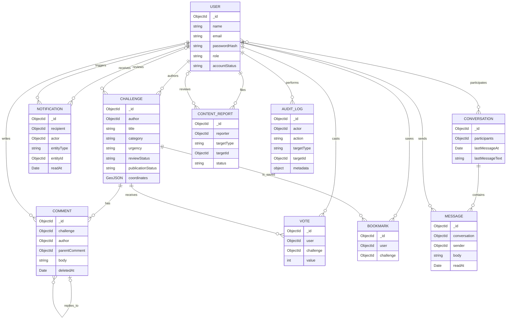

# JanSolve Community — Database Design

## 1. Overview

The application uses **MongoDB** as its system of record and **Mongoose** for
schema validation, model relationships, and indexes. The database is designed
around civic challenge submissions, with separate collections for users,
discussion, engagement, messaging, notifications, reports, and administrative
audit history.

The current implementation stores related records in separate collections and
connects them with MongoDB `ObjectId` references. Challenge evidence and
coordinates are embedded in the challenge document. There are no SQL-style
foreign keys: references and authorization are enforced by application logic.

The database connection uses `ENV.MONGO_URI` in `backend/src/config/db.js`.
The environment configuration supplies a local development default database
name; deployed environments should configure their own MongoDB URI.

## 2. Entity relationship diagram

The diagram describes logical relationships. Some links are polymorphic rather
than database-enforced references: `Notification.entityId`,
`ContentReport.targetId`, and `AuditLog.targetId` point to different model
types depending on their accompanying type field.

## 3. Collections and document designs

Mongoose models are declared under `backend/src/models/` and exported through
`backend/src/models/index.js`. Unless a collection is explicitly configured,
Mongoose uses its standard lower-case pluralized collection name.

### `users` — `User`

Stores citizen and administrator accounts.

| Field | Type | Rules / purpose |
|---|---|---|
| `name` | String | Required, trimmed, maximum 100 characters |
| `email` | String | Required, trimmed, lower-case, valid email, unique |
| `passwordHash` | String | Required bcrypt hash; excluded from normal query selection and JSON |
| `avatar` | String | Optional URL/path; defaults to empty string |
| `bio` | String | Optional; maximum 300 characters |
| `location` | String | Defaults to `Jharkhand, India` |
| `role` | String | `user` or `admin`; defaults to `user` |
| `accountStatus` | String | `active` or `suspended`; defaults to `active` |
| `createdAt`, `updatedAt` | Date | Mongoose timestamps |

Indexes: unique `email` (from `unique: true`), `role`, and `accountStatus`.
The model provides a bcrypt password comparison method and removes
`passwordHash` from serialized JSON.

### `challenges` — `Challenge`

The principal civic report and the unit displayed in JanFeed.

| Field | Type | Rules / purpose |
|---|---|---|
| `title` | String | Required, trimmed, 5–200 characters |
| `description` | String | Required, trimmed, 20–4000 characters |
| `category` | String | Required; one of the 12 challenge categories |
| `urgency` | String | `low`, `medium`, `high`, `critical`; defaults to `medium` |
| `locationText` | String | Required, trimmed, maximum 250 characters |
| `coordinates` | GeoJSON Point | Optional; `coordinates` order is `[longitude, latitude]`, ranges are validated |
| `affectedPeople` | String | Optional description; defaults to empty string |
| `duration` | String | Optional duration description; defaults to empty string |
| `evidence` | Embedded array | Each entry has required `url`, `fileType`, `publicId`, and `originalName`; embedded entries have no `_id` |
| `author` | ObjectId → `User` | Required author reference |
| `reviewStatus` | String | `submitted`, `under_review`, `information_requested`, `verified`, or `rejected`; defaults to `submitted` |
| `publicationStatus` | String | `pending_review`, `published`, or `removed`; defaults to `pending_review` |
| `reviewedBy` | ObjectId → `User` | Optional administrator reference; defaults to null |
| `reviewedAt` | Date | Review timestamp; defaults to null |
| `reviewNote` | String | Administrative feedback; defaults to empty string |
| `publishedAt` | Date | Publication timestamp; defaults to null |
| `voteScore` | Number | Cached net score; defaults to 0 |
| `upvotesCount`, `downvotesCount` | Number | Cached vote totals; default to 0 |
| `commentCount` | Number | Cached comment total; defaults to 0 |
| `viewCount` | Number | View counter; defaults to 0 |
| `createdAt`, `updatedAt` | Date | Mongoose timestamps |

Categories: `Education`, `Healthcare`, `Agriculture`, `Water Resources`,
`Environment`, `Energy`, `Infrastructure`, `Sanitation`, `Accessibility`,
`Rural Livelihoods`, `Public Services`, and `Other`.

Indexes declared in the schema:

- `coordinates: 2dsphere` for geospatial queries.
- `{ publicationStatus: 1, createdAt: -1 }` for newest public feed.
- `{ publicationStatus: 1, voteScore: -1 }` for score-ranked public feed.
- `{ publicationStatus: 1, category: 1 }` and
  `{ publicationStatus: 1, urgency: 1 }` for feed filters.
- `{ reviewStatus: 1, createdAt: -1 }` for review queues.
- Text index over `title`, `description`, and `locationText`.
- Field indexes on `author`, `reviewStatus`, and `publicationStatus`.

**Important state model:** `reviewStatus` and `publicationStatus` are
independent axes. Public feed and nearby queries filter on
`publicationStatus: published`. Admin review can transition review state; a
`verified` review automatically publishes a pending challenge, while a
`rejected` review leaves it unpublished. Never infer visibility solely from
`reviewStatus`.

### `comments` — `Comment`

Stores top-level comments and replies. A reply is another comment document
whose `parentComment` points at its parent.

| Field | Type | Rules / purpose |
|---|---|---|
| `challenge` | ObjectId → `Challenge` | Required |
| `author` | ObjectId → `User` | Required |
| `body` | String | Required, trimmed, maximum 2000 characters |
| `parentComment` | ObjectId → `Comment` | Optional; null means top-level comment |
| `deletedAt` | Date | Null until soft-deleted |
| `createdAt`, `updatedAt` | Date | Mongoose timestamps |

Indexes: individual indexes on `challenge`, `author`, and `parentComment`;
compound `{ challenge: 1, createdAt: 1 }` and
`{ parentComment: 1, createdAt: 1 }`.

Deleting a comment sets `deletedAt`; reads mask its body with a deleted
placeholder, preserving the reply tree. Creating a comment increments the
challenge's cached `commentCount`.

### `votes` — `Vote`

Stores one current vote by one user on one challenge.

| Field | Type | Rules / purpose |
|---|---|---|
| `user` | ObjectId → `User` | Required |
| `challenge` | ObjectId → `Challenge` | Required |
| `value` | Number | Required; `1` for upvote or `-1` for downvote |
| `createdAt`, `updatedAt` | Date | Mongoose timestamps |

Indexes: unique compound `{ user: 1, challenge: 1 }` and `{ challenge: 1 }`.
The unique compound index enforces one active vote per user/challenge pair.
The controller toggles the same vote off and changes the value when the user
switches direction. The challenge document also stores the aggregate counters
for feed efficiency.

### `bookmarks` — `Bookmark`

Stores saved challenges.

| Field | Type | Rules / purpose |
|---|---|---|
| `user` | ObjectId → `User` | Required |
| `challenge` | ObjectId → `Challenge` | Required |
| `createdAt`, `updatedAt` | Date | Mongoose timestamps |

Indexes: unique compound `{ user: 1, challenge: 1 }` and
`{ user: 1, createdAt: -1 }` for a user's saved list.

### `notifications` — `Notification`

Stores durable user notification events; the frontend fetches and marks these
as read through HTTP API routes.

| Field | Type | Rules / purpose |
|---|---|---|
| `recipient` | ObjectId → `User` | Required |
| `actor` | ObjectId → `User` | Optional; null for system-originated events |
| `type` | String | Enumerated event type (comment, reply, vote, review/status changes, new message, report action) |
| `entityType` | String | `challenge`, `comment`, `conversation`, or `user` |
| `entityId` | ObjectId | Required polymorphic target; not a Mongoose `ref` |
| `message` | String | Required human-readable text |
| `readAt` | Date | Null means unread |
| `createdAt`, `updatedAt` | Date | Mongoose timestamps |

Indexes: `recipient` and compound
`{ recipient: 1, readAt: 1, createdAt: -1 }` for unread counts and newest-first
inbox queries.

### `conversations` — `Conversation`

Stores one-to-one conversation metadata. Participants are an array of `User`
ObjectIds; the application creates conversations for two users and checks
participant access in the controller.

| Field | Type | Rules / purpose |
|---|---|---|
| `participants` | Array<ObjectId → `User`> | Required participant references |
| `lastMessageAt` | Date | Defaults to now; used to sort inbox |
| `lastMessageText` | String | Preview, maximum 300 characters |
| `lastSender` | ObjectId → `User` | Optional reference |
| `createdAt`, `updatedAt` | Date | Mongoose timestamps |

Indexes: `{ participants: 1 }` and
`{ participants: 1, lastMessageAt: -1 }`.

The schema does **not** declare a unique compound index enforcing one
conversation per unordered pair. The controller searches for an existing
conversation before creating one; do not assume the database itself prevents
duplicate conversations under concurrent requests.

### `messages` — `Message`

Stores individual conversation messages.

| Field | Type | Rules / purpose |
|---|---|---|
| `conversation` | ObjectId → `Conversation` | Required |
| `sender` | ObjectId → `User` | Required |
| `body` | String | Required, trimmed, maximum 2000 characters |
| `readAt` | Date | Null until the other participant reads it |
| `createdAt`, `updatedAt` | Date | Mongoose timestamps |

Indexes: individual indexes on `conversation` and `sender`; compound
`{ conversation: 1, createdAt: 1 }` for chronological thread reads. The
conversation's last-message fields are updated on send; unread counts are
computed from unread messages sent by someone other than the current user.

### `contentreports` — `ContentReport`

Stores citizen-submitted moderation reports. `targetType` is `challenge`,
`comment`, or `user`; `targetId` is polymorphic and is not a Mongoose `ref`.

| Field | Type | Rules / purpose |
|---|---|---|
| `reporter` | ObjectId → `User` | Required |
| `targetType` | String | Required; `challenge`, `comment`, or `user` |
| `targetId` | ObjectId | Required target id |
| `reason` | String | Required enumerated report reason |
| `details` | String | Optional, maximum 1000 characters |
| `status` | String | `pending`, `reviewed`, `dismissed`, or `action_taken`; defaults to `pending` |
| `reviewedBy` | ObjectId → `User` | Optional administrator reference |
| `reviewedAt` | Date | Review timestamp |
| `moderationNote` | String | Moderator note |
| `createdAt`, `updatedAt` | Date | Mongoose timestamps |

Indexes: unique `{ reporter: 1, targetType: 1, targetId: 1 }` and
`{ status: 1, createdAt: -1 }`. Despite the schema comment referring to
duplicate *pending* reports, the unique index has no status condition: the
same reporter cannot report the same target again while that report document
exists, regardless of its status.

### `auditlogs` — `AuditLog`

Stores administrative action history. It is designed as append-only
application history, with no `updatedAt` timestamp. The schema itself does not
make documents immutable at the database permission level.

| Field | Type | Rules / purpose |
|---|---|---|
| `actor` | ObjectId → `User` | Required administrator reference |
| `action` | String | Enumerated action (challenge review/publication, user status, report, or moderated comment) |
| `targetType` | String | `Challenge`, `Comment`, `User`, or `ContentReport` |
| `targetId` | ObjectId | Required polymorphic target id |
| `metadata` | Mixed object | Optional transition context, notes, or report details |
| `createdAt` | Date | Creation timestamp only |

Indexes: individual indexes on `actor` and `targetId`, plus
`{ createdAt: -1 }` for newest-first audit history.

## 4. Relationships and cardinalities

- One user can author many challenges; every challenge has one author.
- One challenge can have many comments, votes, and bookmarks.
- One user can write many comments, vote on many challenges, and bookmark many
  challenges.
- One comment may have many replies; a comment has at most one parent comment.
- A user may receive and trigger many notifications. A notification has one
  recipient and an optional actor.
- A conversation has multiple participant references and many messages; every
  message belongs to one conversation and has one sender.
- A user can file many reports. A report has one typed target and may have an
  administrator reviewer.
- An administrator can create many audit entries. Each entry identifies one
  typed target.

`ObjectId` references do not imply automatic cascade behavior. Review delete
flows and related-document cleanup explicitly before adding deletion features;
orphaned votes, comments, bookmarks, messages, or polymorphic references are
not automatically removed by Mongoose.

## 5. Main data flows

### Challenge submission, review, and publication

1. An authenticated citizen submits a challenge.
2. `Challenge` is created with an `author`, optional embedded `evidence` and
   GeoJSON `coordinates`, `reviewStatus: submitted`, and
   `publicationStatus: pending_review`.
3. The author's private submission list can query it, while public feed/map
   queries select only `publicationStatus: published`.
4. An administrator updates review state and notes. Review actions create an
   `AuditLog` and a `Notification` for the author.
5. Publication changes `publicationStatus` to `published`; the challenge then
   becomes visible through public discovery routes. Verification of a pending
   challenge also publishes it.

### Votes and denormalized counters

1. A vote is inserted, removed, or switched in `Vote`.
2. The same request increments or decrements `Challenge.voteScore`,
   `upvotesCount`, and `downvotesCount`.
3. Upvotes may create a notification for the challenge author.

Vote records are the per-user source of truth; challenge counters are cached
aggregates used for fast list rendering. The vote write and counter update are
not wrapped in a MongoDB transaction in the current implementation. If
transactionality or repair/reconciliation is added, account for retries and
partial failures.

### Comments and replies

1. A comment is inserted with its `challenge` and `author`.
2. A reply additionally stores `parentComment`, which must belong to the same
   challenge.
3. The challenge's cached `commentCount` increments.
4. A reply can notify the parent author; a top-level comment can notify the
   challenge author.
5. Soft deletion sets `deletedAt`, retaining the document and its child
   replies.

### Messaging and unread state

1. A conversation document references its participants.
2. Each message is stored separately and references its conversation and
   sender.
3. Sending updates the conversation preview fields and creates a notification
   for the other participant.
4. Reads update `Message.readAt`; unread counts are derived by querying
   messages where the sender differs from the current user and `readAt` is
   null.

### Moderation and audit

1. A citizen creates a `ContentReport` with a typed target id.
2. An administrator reviews it, updates its status, and may remove a challenge,
   soft-delete a comment, or suspend a user.
3. Administrative changes create `AuditLog` documents identifying actor,
   action, target type/id, and metadata.

## 6. Integrity and operational considerations

- Mongoose schema validation protects required fields, enums, lengths, and
  coordinate ranges; Joi validates API request bodies before controllers run.
- Unique indexes enforce unique user email, one vote per user/challenge, one
  bookmark per user/challenge, and one report per reporter/target tuple.
- References are checked by application code; MongoDB does not enforce
  referential integrity for these `ObjectId` values.
- Cached challenge counters improve read efficiency but can drift if a
  multi-document operation partially fails. There is no transaction wrapper in
  the current controllers.
- Collection cleanup is not automatic on referenced-document deletion.
- Challenge media stores metadata/URLs, not the actual binary content. Binaries
  are stored on local disk or via configured Cloudinary storage.
- Avoid placing secrets or connection strings in this document. Configure
  MongoDB access through environment variables and protect `.env` files.

## 7. Source files

- Models: `backend/src/models/`
- Model export registry: `backend/src/models/index.js`
- Database connection: `backend/src/config/db.js`
- Environment configuration: `backend/src/config/env.js`
- Challenge workflow: `backend/src/controllers/challengeController.js` and
  `backend/src/controllers/adminController.js`
- Social interaction logic: `backend/src/controllers/socialController.js`
- Messaging: `backend/src/controllers/messageController.js`

This document describes the current code, not a proposed future schema. When
the implementation changes, update this reference to match the schemas,
indexes, and controller behavior.
